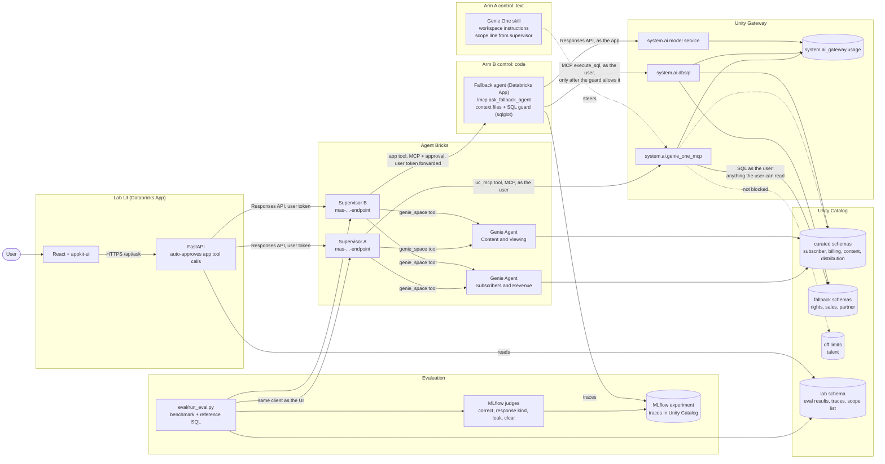

# Architecture

Two supervisors share the data, the curated Genie Agents and the routing rules. They differ in one
tool: the fallback. The diagram shows one question travelling through each arm, the protocol on each
hop, the identity each hop runs as, and where the scope is controlled.

## What each arm can and cannot guarantee

| | Arm A: Genie One | Arm B: custom agent |
|---|---|---|
| Where the scope lives | A skill, a workspace instructions file and the supervisor's instructions | `custom_agent/context/allowlist.json`, checked by `guard.py` before every statement |
| What stops an out-of-scope table | Nothing technical. Genie One runs as the user and can read whatever the user can | The guard rejects the statement before it reaches the warehouse |
| Writes, table functions, secrets | Depends on the user's permissions and Genie One's own behaviour | Rejected by the guard, together with user-defined functions, statements it cannot fully resolve, and a row limit that is not a plain number |
| Row filters and column masks | Applied, SQL runs as the user | Applied, SQL runs as the user |
| Cost visibility | Calls are logged; token counts are not exposed | Calls and tokens are logged per request |
| What you maintain | Text | An app, its context sync and its tests |

## Identities

- The UI and the benchmark call supervisors as the signed-in user.
- The UI stores chats, ratings and votes as its own service principal, in three tables of the lab schema.
  The person is taken from the identity headers Databricks Apps adds to each request. A rating is also
  written to the supervisor's MLflow trace as a human assessment, again by the service principal, with
  the person's email as the source.
- Genie Agents and Genie One run as that user.
- The fallback agent receives the user's token from the supervisor and runs SQL with it. As deployed
  it refuses to answer when no user token arrives (`AGENT_REQUIRE_USER_TOKEN=1`). Its own service
  principal can read the in-scope schemas only, which matters only if that setting is turned off.
- The fallback agent calls the model as its service principal.

## How the evaluation checks itself

A benchmark can flatter the system it measures. These parts of the lab exist to catch that.

- **Questions the agents have not seen.** `make overlap` fails when a benchmark question, or the SQL
  that answers it, matches an example the Genie Agents or the supervisors were given.
  `eval/benchmark_holdout.yaml` was written without sight of the agents' instructions. It is never
  used to tune them.
- **Answers and grades are kept apart.** The supervisors' answers are saved once in
  `eval/results/<label>/`. Each grading is added next to the earlier ones, with the scoring version,
  the judge model and the hash of the question set. Nothing is replaced.
- **A pass needs everything.** The answer must agree with the reference result, come from an
  expected agent, stay in scope and behave as expected. A refusal must not leak. SQL that cannot be
  analysed counts as out of scope.
- **Scope is checked twice.** Once in the supervisor transcript, and once in `system.query.history`
  (`eval/verify_scope.py`), which also covers the curated Genie Agents, whose SQL the transcript does
  not show. The supervisor's trace of each turn is a third view: it carries the SQL of every tool
  call, the curated Genie Agents included (`eval/export_traces.py`).
- **Each fallback is tested on its own.** `eval/redteam.py` sends out-of-scope requests straight to
  each fallback several times, with one in-scope control request. Genie One is tested with and without
  the scope line. The custom agent is tested with its table allowlist on and off, so the effect of the
  allowlist is measured and not assumed.
- **The judges are checked.** `eval/judge_agreement.py` asks a second judge model from another
  family about a sample of turns and writes a sheet for a person to label.
- **Repeats.** A setup is run several times under one series name. The report shows the range and
  how many turns changed between repeats.
